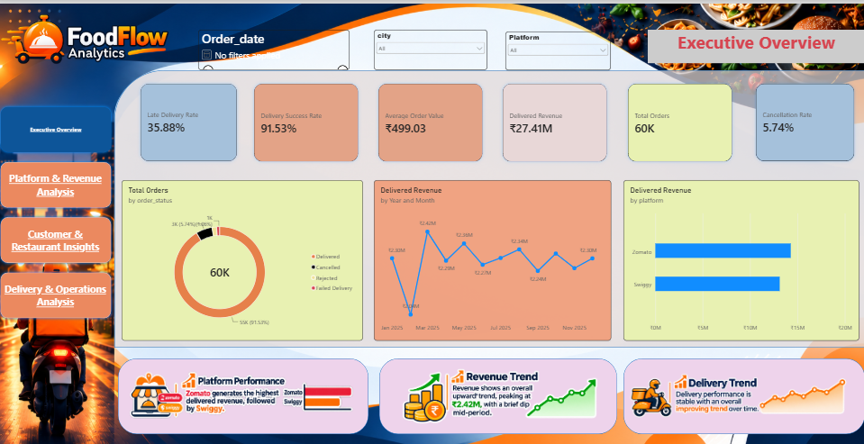
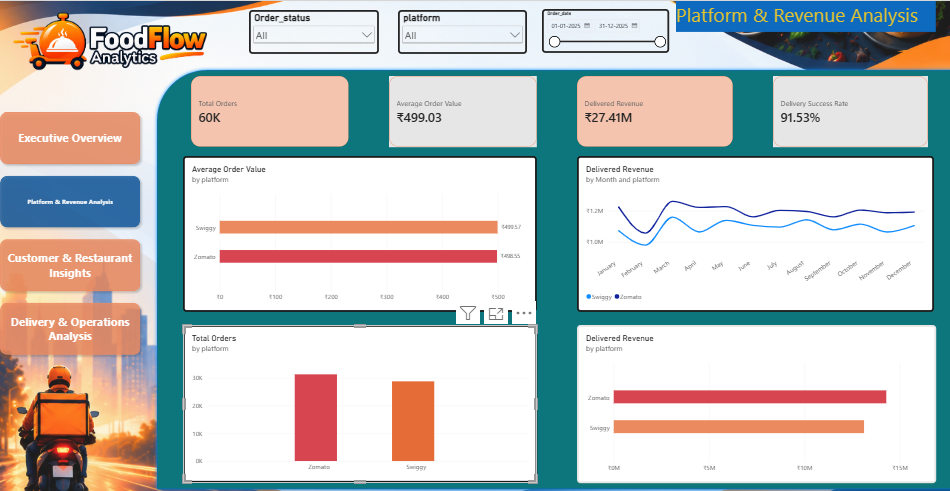
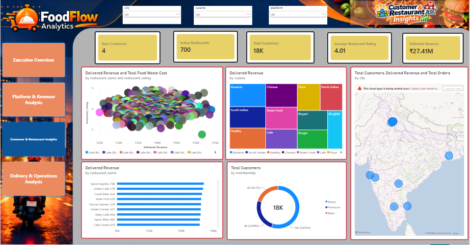

# 🍔 FoodFlow Analytics | End-to-End Food Delivery Business Intelligence

<p align="center">
  <strong>Turning Food Delivery Data into Business Insights with Excel, SQL, Python & Power BI</strong>
</p>

<p align="center">
  
  
  
  
</p>

---

## 📌 Project Overview

**FoodFlow Analytics** is an end-to-end food delivery business intelligence project designed to analyze order transactions, revenue performance, customer behavior, restaurant performance, and delivery operations.

The project follows a complete data analytics workflow, starting with raw dataset preparation and validation in Excel, followed by relational database analysis in MySQL, exploratory data analysis using Python, and finally the development of a four-page interactive Power BI dashboard.

The objective is to transform raw food delivery data into meaningful business insights that help understand revenue trends, platform performance, customer segments, restaurant contribution, and delivery efficiency.

> **Project scope:** This project uses a synthetic food delivery dataset modeled around a Zomato/Swiggy-style business scenario. It is not proprietary data from either platform.

## 🎯 Business Objectives

- Analyze overall order volume, revenue, average order value, and order status distribution.
- Compare Zomato and Swiggy based on orders, delivered revenue, and business performance.
- Understand customer membership, purchasing behavior, and new versus returning customer segments.
- Identify high-performing restaurants and revenue contribution by cuisine.
- Evaluate delivery time, traffic conditions, distance, rider performance, and late deliveries.
- Build an interactive dashboard to support data-driven business monitoring and decision-making.

## 📊 Dataset Overview

The project uses a synthetic food delivery dataset covering **January 2025 to December 2025**.

| Dataset | Records | Description |
|---|---:|---|
| Orders | 60,000 | Order transactions, platform, status and financial details |
| Customers | 18,000 | Customer demographics, city and membership information |
| Restaurants | 700 | Restaurant details, cuisine, location and ratings |
| Riders | 2,200 | Rider details, vehicle type and experience |
| Food Items | 450 | Food categories, prices and preparation information |
| Order Items | 127,972 | Item-level order details and quantities |
| Delivery | 60,000 | Distance, traffic, weather and delivery timings |
| Cancellations | 4,443 | Cancellation reasons, stages and financial impact |
| Complaints | 5,350 | Customer complaints and resolution details |
| Food Waste | 4,735 | Prepared, sold and wasted food quantities |

Additional datasets include refunds, promotions and order-promotion mappings.

## 🛠️ Technology Stack

| Technology | Application |
|---|---|
| Microsoft Excel | Data cleaning, validation, formulas, KPI calculations and feature engineering |
| MySQL | Database creation, table design, data loading, joins and business analysis |
| Python | Data preprocessing, exploratory data analysis and visualization |
| Pandas | Data manipulation, grouping and aggregation |
| NumPy | Numerical operations |
| Matplotlib | Business data visualization |
| Power BI | Interactive dashboard development |
| DAX | KPI measures and business calculations |
| Jupyter Notebook | Python analysis environment |
| Git & GitHub | Project organization and version control |

---

# 🔄 Project Workflow

## 1. Excel — Data Preparation & Validation

The first phase focused on converting raw order data into an analysis-ready dataset.

**Activities performed:**

- Preserved the original order dataset and created a separate working sheet.
- Checked duplicate order IDs, missing values and invalid records.
- Validated monetary values and order-level financial calculations.
- Created analytical columns using Excel formulas.
- Prepared time-based and order-value categories for further analysis.

**Key Excel features used:**

- `IF`, `IFERROR`, `SUM`, `COUNTIF`, `SUMIF`
- `YEAR`, `MONTH`, `TEXT`, `HOUR`
- Sorting, filtering and data validation
- Financial consistency checks
- Analytical column creation

**Data validation results documented in the Excel phase report:**

- 60,000 order records inspected.
- 0 duplicate order IDs found.
- 0 missing values in the inspected original order fields.
- Financial calculation differences were checked and the validation showed 0 difference.

**Analytical features created:**

- Year, month, month name and day name.
- Order hour and meal period.
- Discount percentage.
- Order value category.
- Delivery time slot.

**Deliverables:** `02_Excel/FoodFlow_Analysis.xlsx` and the Excel phase validation report.

## 2. MySQL — Database Design & Business Analysis

The second phase focused on creating a relational database and extracting business insights using SQL.

**Activities performed:**

- Created the `foodflow_analytics` database.
- Designed and populated tables for orders, customers, restaurants, riders, food items, order items, deliveries and cancellations.
- Loaded CSV data and validated imported records.
- Checked relationships and invalid foreign-key references.
- Performed multi-table business analysis using SQL queries.

**SQL concepts applied:**

- Database and table creation.
- Primary keys and foreign keys.
- `INNER JOIN` and `LEFT JOIN`.
- `GROUP BY`, `ORDER BY` and aggregate functions.
- `CASE WHEN` conditional logic.
- Common Table Expressions (CTEs).
- Window functions using `LAG()`.
- Month-over-month revenue comparison.
- Customer, platform and operational analysis.

**Business questions investigated:**

1. Which platform generates higher delivered revenue?
2. What is the average order value for each platform?
3. What percentage of orders are delivered, cancelled or rejected?
4. How does revenue change month by month?
5. Which customer membership groups contribute to revenue?
6. What are the major delivery and cancellation patterns?

**Deliverable:** SQL database setup, table creation, data loading and business analysis scripts in `03_SQL Project script/`.

## 3. Python — Exploratory Data Analysis (EDA)

The third phase used Python to explore the dataset, understand patterns and visualize business performance.

**Libraries used:**

- Pandas
- NumPy
- Matplotlib
- SQLAlchemy

**Activities performed:**

- Loaded and inspected order, delivery and cancellation data.
- Checked dataset dimensions, data types, duplicates and missing values.
- Validated numeric and financial fields.
- Converted date and time columns into appropriate formats.
- Created year, month, day, hour and meal-period features.
- Calculated overall business KPIs.
- Compared platform-level performance.
- Analyzed monthly revenue, delivery times and cancellation reasons.

**Visualizations created:**

- Monthly delivered revenue trend.
- Delivered revenue by platform.
- Cancellation reasons.
- Average delivery time by traffic level.

**Deliverables:**
- `04_Python/FoodFlow_EDA.ipynb`
- `04_Python/visualizations/`
- `04_Python/requirements.txt`

## 4. Power BI — Interactive Business Intelligence Dashboard

The final phase transformed the analysis into a **four-page interactive Power BI dashboard** using DAX measures, KPI cards, slicers and business-focused visualizations.

### Page 1 — Executive Overview

Provides a high-level view of the overall business performance.

**KPIs:**
- Total Orders
- Delivered Revenue
- Average Order Value
- Delivery Success Rate
- Cancellation Rate
- Late Delivery Rate

**Visualizations:**
- Total orders by order status.
- Delivered revenue by platform.
- Monthly delivered revenue trend.
- Executive-level business insights.





### Page 2 — Platform & Revenue Analysis

Focuses on comparing food delivery platform performance.

**Analysis includes:**
- Order volume by platform.
- Delivered revenue comparison.
- Monthly revenue trends.
- Average order value by platform.
- Platform-level business performance.





### Page 3 — Customer & Restaurant Insights

Focuses on customer segmentation, restaurant contribution and geographical distribution.

**Analysis includes:**
- Customer distribution by membership.
- Customer distribution by city.
- Top 10 restaurants by delivered revenue.
- Revenue contribution by cuisine.
- Restaurant rating and revenue performance.
- New versus returning customer analysis.





### Page 4 — Delivery & Operations Analysis

Focuses on operational efficiency and delivery performance.

**Analysis includes:**
- Average delivery time by traffic level.
- Delivery time distribution.
- Delivery distance versus actual delivery time.
- Rider and vehicle performance comparison.


---

# 📈 Key Business Findings

The following findings are based on the dataset and dashboard KPI calculations.

## 1. Overall Business Performance

| KPI | Result |
|---|---:|
| Total Orders | 60,000 |
| Delivered Orders | 54,920 |
| Delivered Revenue | ₹27.41 Million |
| Average Order Value | ₹499.03 |
| Delivery Success Rate | 91.53% |
| Cancellation Rate | 5.74% |

**Insight:** The dataset contains 60,000 orders, with 54,920 successfully delivered orders generating approximately ₹27.41 million in delivered revenue.

## 2. Platform Performance

| Platform | Total Orders | Delivered Revenue |
|---|---:|---:|
| Zomato | 31,263 | ₹14.29M |
| Swiggy | 28,737 | ₹13.12M |

**Insight:** Zomato leads in both order volume and delivered revenue in this dataset, while Swiggy contributes a substantial share of overall business activity.

## 3. Order Status Analysis

| Order Status | Orders | Percentage |
|---|---:|---:|
| Delivered | 54,920 | 91.53% |
| Cancelled | 3,445 | 5.74% |
| Rejected | 998 | 1.66% |
| Failed Delivery | 637 | 1.06% |

**Insight:** Delivered orders account for the majority of transactions. Cancellations, rejections and failed deliveries represent opportunities for further operational investigation.

## 4. Revenue Trend Analysis

- Monthly delivered revenue was highest in **March 2025**, at approximately ₹2.42M.
- February 2025 recorded approximately ₹2.04M.
- Monthly revenue remained within an approximate range of ₹2.04M–₹2.42M throughout the year.

**Insight:** Revenue fluctuated across the year, making monthly monitoring useful for understanding changes in business performance.

## 5. Delivery Operations

| Operational Metric | Result |
|---|---:|
| Average Actual Delivery Time | 43.43 minutes |
| Average Delivery Distance | 3.30 km |
| Late Delivery Rate | 35.88% |

**Insight:** Delivery data can be further segmented by traffic, distance, weather and vehicle type to identify operational patterns and potential delay drivers.

*Late Delivery Rate is calculated only from records with a known late-delivery flag. It should not be confused with the overall delivery success rate.*


These measures support interactive reporting through page filters and slicers.

---

# 📁 Project Structure

```text
FoodFlow_Analytics/
│
├── 01_Raw_Data/
│   ├── cancellations.csv
│   ├── complaints.csv
│   ├── customers.csv
│   ├── delivery.csv
│   ├── food_items.csv
│   ├── order_items.csv
│   ├── restaurants.csv
│   └── riders.csv
│
├── 02_Excel/
│   ├── FoodFlow_Analysis.xlsx
│   └── FoodFlow_Excel_Phase_Report.pdf
│
├── 03_SQL Project script/
│   ├── 01_Database_Setup.sql
│   ├── 02_Create_Tables.sql
│   ├── 03_Load_Data.sql
│   ├── 04_Create_Dimension_Tables.sql
│   ├── 05_order_items.sql
│   ├── 06_Business_Analysis.sql
│   ├── 06_delivery.sql
│   └── 07_cancellations.sql
│
├── 04_Python/
│   ├── FoodFlow_EDA.ipynb
│   ├── requirements.txt
│   └── visualizations/
│       ├── cancellation_reasons.png
│       ├── delivery_by_traffic.png
│       ├── monthly_revenue.png
│       └── platform_revenue.png
│
├── 05_PowerBI/
│   ├── FoodFlow_Analytics_Dashboard.pbix
│   └── swiggy dashboard.pbix
│
├── 06_Dashboard_Images/
│   ├── 01_Executive_Overview.png
│   ├── 02_Platform_Revenue.png
│   ├── 03_Customer_Restaurant.png
│   └── Delivery & Operation Analysis.png
│
├── orders.csv
├── food_waste.csv
├── order_promotions.csv
├── promotions.csv
├── refunds.csv
│
└── README.md


---

# 💡 Business Value & Practical Applications

The analysis provides a foundation for food delivery business teams to:

- Monitor revenue, order volume and delivery performance.
- Compare platform-level performance and identify revenue contribution.
- Understand customer segments and purchasing patterns.
- Identify high-performing restaurants and cuisine categories.
- Investigate late deliveries through traffic, distance and rider-related factors.
- Monitor cancellations, complaints, refunds and food-waste records.
- Support operational planning through consistent KPI reporting.

These are analytical use cases and potential applications; the project does not claim measured real-world cost savings or operational improvements.

# 🔮 Future Enhancements

- Develop predictive models for delivery-time estimation.
- Build customer churn and repeat-purchase prediction models.
- Analyze cancellation probability and its major drivers.
- Develop food-waste forecasting and reduction strategies.
- Add automated data refresh and scheduled reporting.
- Build a deployment-ready analytics application.

# 👨‍💻 Author

**Deepanshu Gond**

Aspiring Data Analyst | Business Intelligence | SQL | Python | Power BI

Interested in transforming raw data into meaningful business insights through data analytics, visualization and business intelligence.

---

<p align="center">
  <strong>FoodFlow Analytics — From Raw Data to Business Insights.</strong>
</p>
